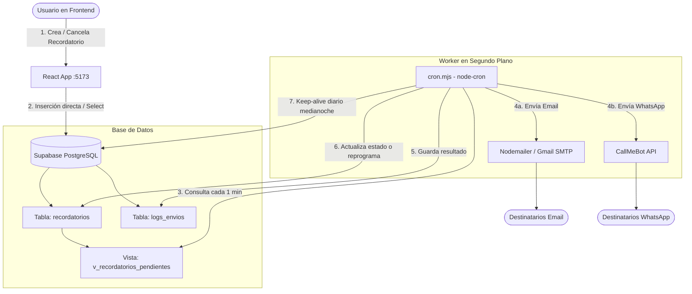

# 🤖 Contexto del Proyecto: Sistema de Recordatorios Automatizado (agent.md)

Este documento contiene la guía técnica, arquitectura, decisiones de diseño y contexto operativo del proyecto **Recordatorios**, diseñado para que cualquier agente de inteligencia artificial (IA) o desarrollador pueda entender, mantener y extender la aplicación sin ambigüedades.

---

## 📌 1. Visión General del Proyecto

**Recordatorios** es una aplicación full-stack para la creación, programación y despacho automatizado de notificaciones y recordatorios a través de **Correo Electrónico (Email)** y **WhatsApp**.

El sistema se compone de:
1. **Frontend Web SPA (React + Vite)**: Interfaz de usuario moderna con estética *Dark Glassmorphism* para crear, listar, filtrar y cancelar recordatorios.
2. **Base de Datos & Backend Serverless (Supabase / PostgreSQL)**: Almacén central de recordatorios, registros de auditoría/logs y una vista SQL inteligente que calcula en tiempo real qué eventos están listos para enviarse.
3. **Daemon / Worker en Background (`cron.mjs`)**: Proceso continuo en Node.js que revisa minuto a minuto los eventos pendientes, envía correos mediante SMTP (Gmail) y mensajes por WhatsApp (CallMeBot), y gestiona recurrencias y keep-alive.

---

## 🏗️ 2. Arquitectura y Flujo de Datos



---

## 📂 3. Estructura del Repositorio

```
Recordatorios/
├── .env                     # Variables de entorno (Supabase, SMTP, CallMeBot)
├── .gitignore               # Ignora node_modules, .env, dist
├── agent.md                 # Este documento de contexto para IAs y desarrolladores
├── cron.mjs                 # Servicio worker/cron en Node.js para envíos y keep-alive
├── mailer.mjs               # Módulo centralizado de emails, plantillas HTML y .ics
├── netlify.toml             # Configuración de despliegue y redirects de Netlify
├── netlify/
│   └── functions/
│       ├── check-reminders.mjs   # Serverless Cron / Webhook
│       └── send-confirmation.mjs # API para despacho inmediato al agendar
├── index.html               # Entrada HTML con fuentes Google (Inter)
├── package.json             # Dependencias y scripts npm
├── supabase_schema.sql      # Definición de tablas, vistas, índices y RLS en PostgreSQL
├── vite.config.js           # Configuración de Vite con middleware de dev para /api
└── src/
    ├── api.js               # Métodos de acceso a Supabase y llamada a send-confirmation
    ├── App.jsx              # Componente principal React (Formulario, Lista, Filtros, Badges)
    ├── index.css            # Estilos globales, variables CSS y clases glassmorphism
    ├── main.jsx             # Punto de entrada de React DOM
    └── supabase.js          # Inicialización del cliente Supabase para el cliente web
```

---

## 🗄️ 4. Modelo de Datos (PostgreSQL en Supabase)

### Tabla `recordatorios`
| Columna | Tipo | Descripción |
|---|---|---|
| `id` | `UUID` (PK) | Identificador único generado por `gen_random_uuid()`. |
| `titulo` | `TEXT` | Título o asunto del recordatorio (requerido). |
| `descripcion` | `TEXT` | Detalle o cuerpo del mensaje (opcional). |
| `fecha_hora` | `TIMESTAMPTZ` | Fecha y hora programada para el evento. |
| `anticipacion` | `INTEGER` | Minutos de antelación con los que se debe enviar la notificación (ej. 15, 30, 60, 1440). |
| `recurrencia` | `TEXT` | `'ninguna'`, `'diario'`, `'semanal'`, `'mensual'`. |
| `canal` | `TEXT` | `'email'`, `'whatsapp'`, `'ambos'`. |
| `destinatario_wa` | `TEXT` | Números con código de país, separados por comas (ej. `5212229137794`). |
| `destinatario_email`| `TEXT` | Correos separados por comas. Predeterminado: `vikitomas1453@gmail.com`. |
| `estado` | `TEXT` | `'pendiente'`, `'enviado'`, `'cancelado'`. |
| `confirmacion_enviada` | `BOOLEAN` | Bandera interna. |
| `created_at` | `TIMESTAMPTZ` | Timestamp de creación. |

### Vista `v_recordatorios_pendientes`
```sql
CREATE OR REPLACE VIEW public.v_recordatorios_pendientes
  WITH (security_invoker = on) AS
SELECT * FROM recordatorios
WHERE estado = 'pendiente'
  AND (fecha_hora - anticipacion::double precision * '00:01:00'::interval) <= now()
  AND fecha_hora > (now() - '01:00:00'::interval);
```
> **Nota de lógica temporal:** Un recordatorio entra a la vista cuando la hora actual `now()` ha superado `(fecha_hora - anticipacion)`. Además, descarta eventos que tengan más de 1 hora de antigüedad para evitar envíos zombies en caso de caídas prolongadas.

### Tabla `logs_envios`
Almacena la trazabilidad de cada despacho:
- `recordatorio_id` (UUID FK)
- `canal` (`'email'` o `'whatsapp'`)
- `destinatario` (string)
- `estado` (`'ok'` o `'error'`)
- `error_msg` (mensaje en caso de falla)
- `created_at` (TIMESTAMPTZ)

---

## ⚙️ 5. Configuración de Variables de Entorno (`.env`)

Las siguientes variables son requeridas para la ejecución de la app y del worker:

```env
# --- Supabase (Acceso Web y Node) ---
VITE_SUPABASE_URL=https://<TU-PROYECTO>.supabase.co
VITE_SUPABASE_ANON_KEY=<TU-ANON-KEY>

# --- WhatsApp (CallMeBot) ---
CALLMEBOT_API_KEY=<TU_API_KEY>

# --- Email SMTP (Nodemailer / Gmail) ---
SMTP_HOST=smtp.gmail.com
SMTP_PORT=587
SMTP_SECURE=false
SMTP_USER=tu_cuenta@gmail.com
SMTP_PASS=xxxx xxxx xxxx xxxx   # App Password de 16 caracteres de Google (No la clave regular)
EMAIL_FROM_NAME="Recordatorios"
```

> ⚠️ **Importante sobre Gmail SMTP:** Google exige activar **Verificación en 2 pasos** y generar una **Contraseña de Aplicación (App Password)** de 16 caracteres para usar SMTP.

---

## 🚀 6. Comandos y Ejecución

| Comando | Acción |
|---|---|
| `npm run dev` | Inicia el servidor de desarrollo de Vite (Frontend en `http://localhost:5173`). |
| `npm run cron` | Inicia el demonio `cron.mjs` en terminal (Node.js). Revisa eventos cada minuto. |
| `npm run build` | Compila el bundle de producción en `/dist`. |
| `npm run preview` | Previsualiza el build de producción localmente. |

---

## 💡 7. Detalles Clave para Futuros Agentes / IAs

1. **Multi-destinatarios:** Los campos `destinatario_email` y `destinatario_wa` admiten listas separadas por comas. Tanto el frontend como `cron.mjs` usan `parsearDestinatarios` para dividirlos y enviar a cada uno.
2. **Manejo de Recurrencias:** Cuando un recordatorio con recurrencia (`diario`, `semanal`, `mensual`) es procesado, **no** cambia a `'enviado'`. En su lugar, `cron.mjs` calcula la siguiente fecha (`calcularProximaFecha`) y actualiza `fecha_hora` manteniéndolo en `'pendiente'`.
3. **Keep-Alive de Supabase:** Los proyectos en el tier gratuito de Supabase se pausan si pasan 7 días sin tráfico. En `cron.mjs` hay un job programado a medianoche (`0 0 * * *`) que realiza una consulta `count: 'exact', head: true` para mantener vivo el servicio.
4. **Resend vs. SMTP:** El proyecto originalmente evaluó Resend, pero se migró a **Nodemailer SMTP (Gmail)** para permitir enviar recordatorios libremente a cualquier destinatario sin limitaciones de dominio verificado del plan gratuito.
5. **WhatsApp:** Actualmente utiliza CallMeBot. Para producción a escala, se puede migrar fácilmente a WhatsApp Cloud API (Meta), Twilio, o servicios self-hosted como Evolution API o Baileys conservando la misma interfaz en `cron.mjs`.
6. **Integración con Calendarios (Google, Outlook, Apple .ics):**
   - Cada correo despachado por `cron.mjs` incluye botones interactivos con enlaces directos para agendar el evento en **Google Calendar** y **Outlook Calendar Web**.
   - Se genera dinámicamente un archivo adjunto estándar **`.ics` (iCalendar / RFC 5545)** con `METHOD: REQUEST` y el objeto `icalEvent` de Nodemailer, lo que activa la detección nativa de invitaciones de calendario en Apple Mail (iOS/Mac), Outlook Desktop y Gmail.
   - En los mensajes de WhatsApp también se incluye el enlace directo a Google Calendar para agendar el evento con un solo toque desde el chat.
7. **Ciclo de Vida de Notificaciones (Doble Correo):**
   - **Correo 1: Confirmación de Agendado**: Al crearse el recordatorio en Supabase entra con `confirmacion_enviada = false`. El sistema (`cron.mjs` o la función serverless de Netlify) detecta los registros con `confirmacion_enviada = false` y despacha de inmediato un correo de confirmación con la ficha técnica completa del evento, los botones para guardarlo en calendario y el archivo `.ics`. Luego actualiza `confirmacion_enviada = true`.
   - **Correo 2: Notificación Próxima (Aviso)**: Cuando el tiempo actual alcanza el momento de anticipación configurado `(fecha_hora - anticipacion <= now())`, entra en la vista `v_recordatorios_pendientes` y se despacha el correo de alerta (`¡Es la hora de tu recordatorio!`). Al finalizar, se marca el recordatorio como `'enviado'` (o se reprograma si tiene recurrencia).


---

## 🌐 8. Despliegue en Netlify

El proyecto cuenta con configuración lista para Netlify:
- **`netlify.toml`**: Configura `command = "npm run build"`, `publish = "dist"`, y redirecciones SPA `/* -> /index.html` con status 200.
- **Netlify Serverless Function (`netlify/functions/check-reminders.mjs`)**:
  - Netlify aloja sitios estáticos y funciones serverless, pero **no** mantiene scripts de larga duración (como `node cron.mjs` en bucle infinito).
  - Por ello, se incluye el endpoint serverless `/.netlify/functions/check-reminders`.
  - Puede ser invocado automáticamente cada minuto usando un servicio gratuito de cron web (como [cron-job.org](https://cron-job.org) o EasyCron) configurando una petición HTTP GET a `https://<tu-app>.netlify.app/.netlify/functions/check-reminders`.
  - Alternativamente, el worker `cron.mjs` puede dejarse corriendo en un servicio de background workers 24/7 (como Render Free Tier, Railway o un VPS).
- **Variables de Entorno en Netlify (Site Configuration > Environment Variables):**
  - `VITE_SUPABASE_URL`
  - `VITE_SUPABASE_ANON_KEY`
  - `SMTP_HOST`
  - `SMTP_PORT`
  - `SMTP_SECURE`
  - `SMTP_USER`
  - `SMTP_PASS`
  - `EMAIL_FROM_NAME`
  - `CALLMEBOT_API_KEY`

